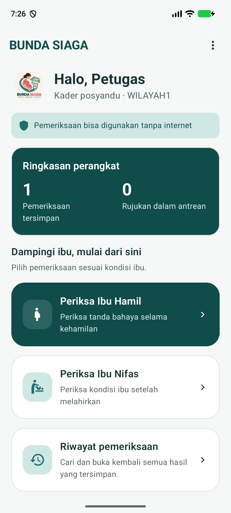
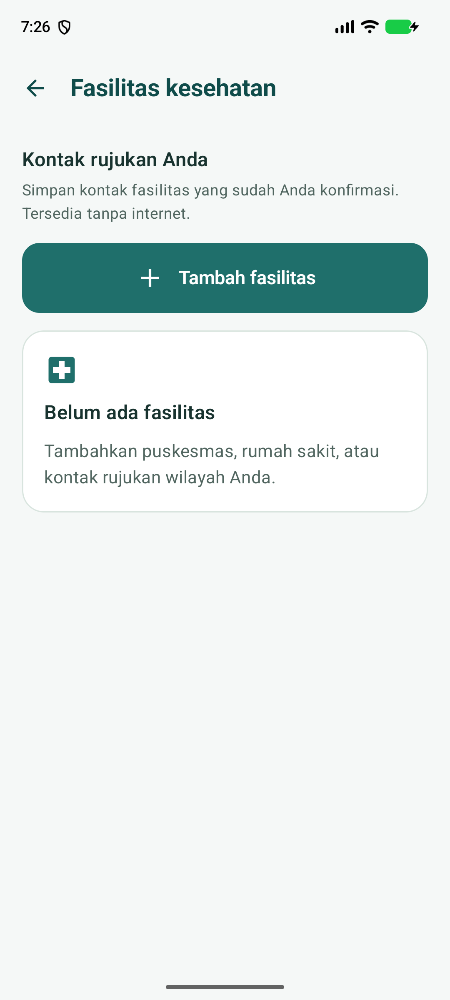

<div align="center">
  
  <h1>BUNDA SIAGA</h1>
  <p><strong>Pendamping pemeriksaan ibu dan koordinasi rujukan, bahkan tanpa internet.</strong></p>
  <p>Android · Kotlin · Jetpack Compose · SMS · Penyimpanan terenkripsi</p>
</div>

BUNDA SIAGA membantu kader posyandu, bidan, dan petugas puskesmas mencatat tanda
bahaya kehamilan serta nifas, menyimpan hasil pemeriksaan, dan berkoordinasi melalui
SMS. Pemeriksaan dan kontak fasilitas dapat digunakan tanpa koneksi internet.
Server rekap wilayah tersedia sebagai komponen opsional.

## Tampilan aplikasi

<p align="center">
  
  &nbsp;
  
</p>

## Fitur

| Kebutuhan | Yang tersedia |
|---|---|
| Pemeriksaan hamil dan nifas | Pertanyaan bertahap, prioritas hijau/kuning/merah, alasan hasil, dan penanda data yang belum lengkap |
| Melanjutkan pekerjaan | Jawaban disimpan di database terenkripsi sebelum pertanyaan berikutnya; pemeriksaan dapat dilanjutkan setelah aplikasi dibuka kembali |
| Riwayat pemeriksaan | Pencarian kode pasien, filter prioritas, dan akses hasil termasuk yang belum dirujuk; hasil arsip tidak dihitung ulang menggunakan aturan baru |
| Koordinasi rujukan | Pratinjau isi SMS, antrean kirim, percobaan ulang, status jaringan, dan balasan petugas puskesmas |
| Kontak fasilitas | Tambah, edit, hapus, cari, dan telepon fasilitas; nomor serta perkiraan perjalanan diisi pengguna |
| Kapasitas layanan | Siaran kapasitas lewat SMS kepada penerima terdaftar, sumber informasi, waktu pembaruan, dan peringatan data lama |
| Privasi | Database SQLCipher, kunci dibungkus Android Keystore, pengiriman memakai kode pasien, dan proteksi tangkapan layar |
| Pengelolaan | Aturan bertanda tangan, metrik lokal, ekspor CSV, serta sinkronisasi rekap ke server opsional |

**Batas penggunaan:** hasil merupakan sinyal prioritas, bukan diagnosis. Aturan
bawaan belum melalui validasi klinis dan harus ditinjau tenaga kesehatan sebelum
digunakan dalam pelayanan pasien. Kontak fasilitas harus dikonfirmasi oleh pengelola
wilayah. Uji SMS dua perangkat fisik dan uji lapangan masih diperlukan.

## Alur penggunaan

1. Pilih peran, isi identitas petugas, kode lokasi, dan nomor puskesmas tujuan.
2. Tambahkan fasilitas kesehatan beserta kontak yang telah dikonfirmasi.
3. Mulai pemeriksaan hamil atau nifas dan isi data awal. Setiap jawaban selanjutnya
   disimpan otomatis sebelum beralih ke pertanyaan berikutnya.
4. Baca hasil, alasan prioritas, dan informasi yang belum lengkap. Hasil otomatis
   masuk ke **Riwayat pemeriksaan**.
5. Bila perlu rujukan, periksa isi serta nomor tujuan SMS sebelum mengirim.
6. Petugas puskesmas membuka rujukan masuk dan membalas **Siap**, **Penuh**, atau
   **Hubungi**. Status kirim dan balasan ditampilkan terpisah.

Pemeriksaan yang tertunda muncul di beranda. Jika versi aturan telah berubah,
pemeriksaan lama tidak dilanjutkan dengan aturan yang berbeda; mulai pemeriksaan baru.
Data awal yang belum dilanjutkan ke pertanyaan belum masuk penyimpanan otomatis.

## Dua varian Android

| | Pilot | Play |
|---|---|---|
| Pemeriksaan, riwayat, kontak fasilitas | Ya | Ya |
| Mengirim SMS | Langsung setelah izin diberikan | Melalui aplikasi SMS bawaan |
| Antrean otomatis dan laporan jaringan | Ya, tergantung perangkat dan operator | Tidak dapat dipantau oleh BUNDA SIAGA |
| Menerima rujukan dan membalas dari aplikasi | Ya | Tidak |
| Peran gateway puskesmas | Ya | Tidak |

Nama varian adalah jalur distribusi. Membuka aplikasi SMS bawaan belum membuktikan
pesan terkirim. Laporan diterima operator juga berbeda dari balasan petugas.

## Menjalankan proyek

Persyaratan: **JDK 17**, Android SDK sesuai `app/build.gradle.kts` (compile SDK 37),
dan Android **8.0 / API 26** atau lebih baru untuk pemasangan aplikasi.
Isi `local.properties` dengan `sdk.dir` sesuai lokasi Android SDK di komputer Anda.

```bash
./gradlew :app:assemblePilotDebug :app:assemblePlayDebug
```

APK hasil build:

- `app/build/outputs/apk/pilot/debug/app-pilot-debug.apk`
- `app/build/outputs/apk/play/debug/app-play-debug.apk`

Build rilis menggunakan keystore sendiri melalui `keystore.properties`.
Tanpa keystore, APK rilis tidak ditandatangani; kunci debug tidak digunakan sebagai
pengganti. Lihat [panduan distribusi](docs/PLAY_STORE.md).

## Pengujian

```bash
./gradlew :rules:test :codec:test :outbox:test :server:test \
  :app:testPilotDebugUnitTest :app:assemblePilotDebug :app:assemblePlayDebug
python3 -m unittest discover -s tests -v
```

Tambahkan `--offline` jika semua dependensi sudah ada di cache.
Cakupan mencakup aturan, format SMS, antrean, server, pemulihan data pemeriksaan,
arsip hasil, validasi input, dan query sinkronisasi. Hasil verifikasi perubahan
terbaru dicatat di [catatan rilis 0.3](docs/RELEASE_0.3.md).

## Server opsional

Aplikasi Android tidak memerlukan server untuk pemeriksaan dan SMS.
Server Ktor + SQLite menyediakan dasbor rekap, penerimaan sinkronisasi gateway,
serta distribusi paket aturan bertanda tangan.

```bash
export BS_TOKENS='<token-acak-minimal-16-karakter>'
export BS_DASH_PASS='<sandi-dasbor>'
./gradlew :server:run
```

Alamat lokal: `http://127.0.0.1:8080`. Gunakan HTTPS untuk akses dari perangkat
produksi. Token di atas harus diganti dan tidak boleh disimpan di Git.
Konfigurasi SATUSEHAT terpisah dan memerlukan akun, kredensial, serta verifikasi
integrasi resmi; keberadaan kode integrasi bukan bukti integrasi telah aktif.

## Struktur

```text
app/       Aplikasi Android, Compose, database terenkripsi, SMS, pekerja latar
rules/     Mesin dan konfigurasi aturan pemeriksaan
codec/     Encoder/decoder pesan SMS BS1
outbox/    Mesin antrean, status pengiriman, dan penerimaan pesan
server/    API, dasbor rekap, SQLite, dan integrasi opsional
tests/    Regresi SQLite terhadap query aplikasi
```

## Dokumentasi

[Panduan penggunaan](docs/PANDUAN_PENGGUNAAN.md) ·
[Deployment](docs/DEPLOYMENT.md) · [Uji manual](docs/MANUAL_TEST.md) ·
[Validasi klinis](docs/CLINICAL_REVIEW.md) ·
[Pembaruan aturan](docs/RULES_UPDATE.md) · [SATUSEHAT](docs/SATUSEHAT.md)
